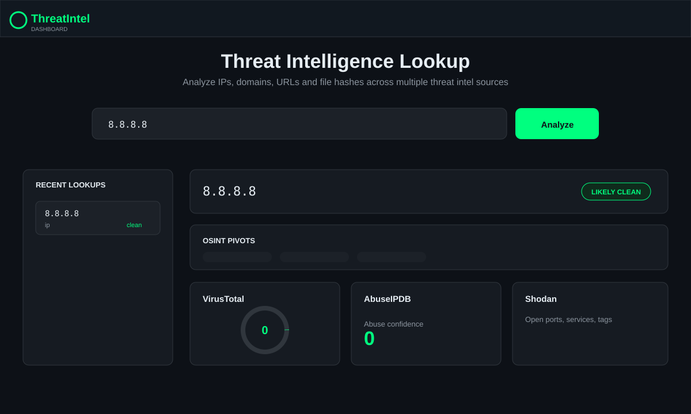

# Threat Intelligence Dashboard

Static threat intelligence dashboard for IP, IPv6, domain, URL and hash lookups using public security APIs directly from the browser.



## Features

- Detects IPv4, IPv6, domains, URLs, MD5, SHA-1 and SHA-256 hashes.
- VirusTotal lookup for IPs, domains, URLs and file hashes.
- AbuseIPDB lookup for IP abuse confidence.
- Shodan lookup for indexed IP services and open ports.
- IPinfo geolocation lookup for IPs without requiring an API key.
- Local lookup history with verdict, type and timestamp.
- Export the current investigation as JSON, Markdown or print-to-PDF.
- No-key OSINT pivots for URLhaus, AlienVault OTX, GreyNoise, Censys and future MISP/OpenCTI investigation.
- API keys are stored only in browser `localStorage`.
- Works as a static site on GitHub Pages with a ready-to-use Actions workflow.

## Run locally

```bash
python3 -m http.server 8080
```

Open `http://localhost:8080`.

## Tests

```bash
npm test
```

## GitHub Pages

The repository includes `.github/workflows/pages.yml`.

1. Push the `main` branch to GitHub.
2. In the repository, go to `Settings > Pages`.
3. Set source to `GitHub Actions`.
4. Pushes to `main` will run tests and publish the static site.

## API keys

Open the gear button in the dashboard and paste your API keys:

- VirusTotal: https://www.virustotal.com/gui/join-us
- AbuseIPDB: https://www.abuseipdb.com/register
- Shodan: https://account.shodan.io/register

Some APIs may enforce CORS, quota or plan restrictions for direct browser requests. When that happens, the dashboard shows a source-specific error card instead of failing the whole lookup.
